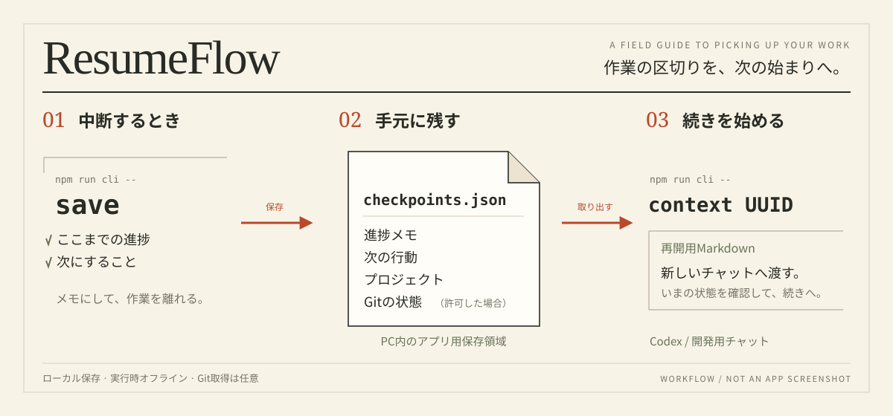

<p align="center">
  
</p>

<h1 align="center">文脈を残して、続きから。</h1>

<p align="center">
  中断メモと次の一手を、ローカルのチェックポイントに。<br>
  <sub>CLI / Codexで開発する人のための、作業の引き継ぎツール。</sub>
</p>

<p align="center">
  <a href="package.json"></a>
  <a href="https://github.com/taku0193/resumeflow/actions/workflows/ci.yml"></a>
  <a href="#privacy"></a>
  <a href="package.json"></a>
</p>

<p align="center">
  <a href="#quick-start">はじめる</a> ·
  <a href="#commands">コマンド</a> ·
  <a href="#codex">Codexで使う</a> ·
  <a href="#privacy">保存とプライバシー</a> ·
  <a href="#development">開発・検証</a>
</p>

---

「どこまでやったか」「次は何をするか」を、次のセッションへ。

ResumeFlowは、メモ・プロジェクト・任意のGit状態を保存し、別のプロセスから**再開用Markdown**として取り出します。エディタ、AI API、サーバーを実行時に必要とせず、オフラインで使えます。

| Capture | Keep local | Resume |
| --- | --- | --- |
| **いまの区切りを残す。**<br>進捗と次の行動をメモに。Git状態の取得は明示的に許可。 | **手元のPCに置く。**<br>プロジェクトごとに記録を分離。ソース本文や端末履歴を自動収集しない。 | **次の会話へ渡す。**<br>一覧から選んで文脈を取得。Codexやほかの開発チャットへ引き継ぐ。 |

## Quick start

**Node.js 22.12以降 / npm**を用意します。初回の依存取得にはネットワーク接続が必要です。

### 1. 準備する

```bash
git clone git@github.com:taku0193/resumeflow.git
cd resumeflow
npm ci
npm run build
npm run cli -- help
```

非公開リポジトリのため、アクセスできるGitHubアカウントで取得します。すでに取得済みなら、そのフォルダで `npm ci` 以降を実行してください。

### 2. 中断するときに保存する

```bash
npm run cli -- save \
  --note "CLI版MVPの実装とE2Eテストが完了した" \
  --next "実際のプロジェクトで保存・再開を試す"
```

`--note` は現在の進捗、`--next` は次回最初にすること。空欄・日本語・改行も保存できます。保存に成功すると記録のUUIDが表示されます。

### 3. 続きを始める

```bash
npm run cli -- list
npm run cli -- context UUID
```

`UUID` を一覧に表示されたIDに置き換えます。出力されたMarkdownを新しいチャットへ貼り付け、「この記録を参考に、現在の状態を確認して続けて」と依頼します。

> [!TIP]
> 操作対象は、コマンドを実行したディレクトリです。上の手順ではResumeFlow自身が対象になります。別の開発プロジェクトには、保存・取得の両方で `--project` を指定します。

<details>
<summary><strong>別のプロジェクトで使う</strong></summary>

`/absolute/path/to/project` を対象プロジェクトの絶対パスに置き換えてください。ResumeFlowのフォルダから実行できます。

```bash
npm run cli -- save --project "/absolute/path/to/project" --note "ここまでの進捗" --next "次にすること"
npm run cli -- list --project "/absolute/path/to/project"
npm run cli -- context UUID --project "/absolute/path/to/project"
```

どの操作でも、同じプロジェクトを指定します。保存ディレクトリを `--data-dir` で変更した場合は、その指定も揃えてください。

</details>

## Commands

| 操作 | コマンド | できること |
| --- | --- | --- |
| 保存 | `npm run cli -- save` | メモ・次の行動・プロジェクトを記録 |
| 一覧 | `npm run cli -- list` | 現プロジェクトの記録を新しい順に表示 |
| 詳細 | `npm run cli -- show UUID` | 指定した記録の内容を表示 |
| 引き継ぎ | `npm run cli -- context UUID` | 再開用Markdownを出力 |
| 削除 | `npm run cli -- delete UUID` | 確認してから、指定した記録だけを削除 |
| ヘルプ | `npm run cli -- help` | 引数と使い方を確認 |

**Gitも記録する場合**は、保存時に `--allow-git` を追加します。取得するのはブランチ・HEAD・変更ファイルの状態で、diff本文は保存しません。Gitの取得に失敗しても、メモの保存は続けます。

```bash
npm run cli -- save --allow-git --note "レビュー待ち" --next "CIを確認する"
```

<details>
<summary><strong>削除の確認・JSON出力・保存先の指定</strong></summary>

削除確認は `y` で承認、`n` またはEnterでキャンセルします。非対話実行には明示の `--yes` が必要です。

機械処理ではCLIを直接呼び出すと、npmの実行案内が混ざりません。

```bash
node dist/cli/main.js list --format json
node dist/cli/main.js show UUID --format json
node dist/cli/main.js context UUID --format json
```

成功はstdoutに `{ "ok": true, "data": ... }`、エラーはstderrのJSONと非0終了コードで返します。全コマンドで `--project` と `--data-dir` を指定できます。`context` の既定はMarkdownです。詳しい形式は [CLI仕様](CLI_SPEC.md) を参照してください。

</details>

## Codex

CLIの実行をCodexに依頼する使い方もできます。対象プロジェクトと、ResumeFlowの場所を伝えてください。

**中断するとき**

> ResumeFlowのCLIを使って、このプロジェクトの進捗と次にすることを保存して。

**再開するとき**

> ResumeFlowのCLIで、このプロジェクトの最新の記録を取り出して。内容を参考に、現在の状態を確認してから続けて。

[同梱skill](skills/resumeflow-checkpoint/SKILL.md) には、保存・一覧・再開をCLIへつなぐ手順があります。ユーザー環境へのskill導入はまだ行っていません。リポジトリにあるだけで自動登録される前提にはしていません。

<details>
<summary><strong>skillとCLIの接続方法</strong></summary>

[bridge.mjs](skills/resumeflow-checkpoint/scripts/bridge.mjs) は、UTF-8のJSONリクエストからCLIを起動します。メモはシェルへ展開せず、引数配列で渡します。

```json
{
  "action": "save",
  "project": "/absolute/path/to/project",
  "note": "現在の進捗",
  "nextAction": "次の一手",
  "allowGit": false
}
```

```bash
node skills/resumeflow-checkpoint/scripts/bridge.mjs /absolute/path/to/request.json
```

`project` は明示した対象だけを使います。`dataDirectory` は省略可能。Git取得は許可がある場合だけ `allowGit: true` にします。メモは現在の依頼で提供された情報からまとめます。skillを別の場所へコピーした場合は `--cli /absolute/path/to/dist/cli/main.js` でCLIの場所を指定できます。

構造検証とbridge→実CLIの保存・取得は確認済みです。自然言語からLLMがskillを選択する評価は未実施です。

</details>

## Privacy

**コードの変更はGitへ。作業の要点はResumeFlowへ。**

チェックポイントは手元のPCに保存し、GitHubや外部サービスへ自動同期しません。ソース本文・未保存バッファ・端末履歴・環境変数の値・Codex内部データは自動収集しません。CLIのエディタ情報は「未取得」として扱います。

| OS | 既定のデータディレクトリ |
| --- | --- |
| macOS | `~/Library/Application Support/ResumeFlow` |
| Windows | ホームフォルダ配下の `AppData/Local/ResumeFlow` |
| Linux等 | `~/.local/share/resumeflow` |

データファイルは `checkpoints.json`。`--data-dir` で変更できます。プロジェクトはrealpathのfile URIで識別し、別プロジェクトの記録を混ぜません。

再開出力は保存した作業文脈です。会話・エージェント内部状態・ファイル・カーソル位置の完全復元は行いません。

<details>
<summary><strong>旧データ・破損・同時書き込み</strong></summary>

新規記録はスキーマ2です。旧スキーマ1は検証して表示できますが、保存・削除は読取専用エラーになります。旧ファイルは保持し、新しい空の `--data-dir` で新規保存してください。自動移行は行いません。

破損JSON・不正UTF-8は変更しません。保存・削除はアプリ専用lockと一時ファイルからの置換で保護し、同時書き込みは `DATA_BUSY` で失敗します。

異常終了で `.write.lock` が残った場合は、書き込みプロセスが動いていないことを確認してから、そのアプリ用lockを手動で取り除きます。古いlockを自動削除する機能はありません。

</details>

## Development

Issue → 機能別ブランチ → 小さな検証済みコミット → PR / CI → マージ・Issue完了、の順で進めます。ローカルのVS Codeを開かず、CodexとCLIで開発できます。

```bash
npm run verify
npm run test:cli:e2e
```

MVP受入時（2026-11-03）は、純粋単体 **174件**、CLI実プロセスE2E **13件** が成功。Node I/O・Git・CLIは **Linux / macOS / Windows** で検証しています。[受入CI](https://github.com/taku0193/resumeflow/actions/runs/41587000318) · [現在のCI](https://github.com/taku0193/resumeflow/actions/workflows/ci.yml)

<details>
<summary><strong>テストの層・コマンド・検証範囲</strong></summary>

| コマンド | 検証する層 | MVP受入時 |
| --- | --- | --- |
| `npm run verify` | 型・純粋単体・Node I/O・ビルド | 単体174件 / I/O 8件 |
| `npm run test:coverage` | models/servicesの単体カバレッジ | statements 99.53% / branches 97.81% |
| `npm run test:tools` | 0件・skip・only等を拒否するゲート | 3件 |
| `npm run test:node:io` | 実ファイルI/O・プロジェクト解決 | 8件 / 3OS |
| `npm run test:node:integration` | 架空リポジトリの実Git | 2件 / 3OS |
| `npm run test:cli:e2e` | 別プロセス操作・skill・配布物 | 13件 / 3OS |
| `python3 scripts/cli-tty-e2e.py` | 実端末での取消・承認（ビルド後） | 2件 / Linux CI・ローカルmacOS |
| `npm run test:e2e:package` | GUIなしのVSIX配布対象検査 | 成功 |
| `npm run test:integration` | CI / Xvfb内のVS Code API統合 | 15件 / Linux |
| `npm run test:e2e` | CI / Xvfb内の実VS Code UIスモーク | 1件 / Linux |

ローカルはmacOS / Node26、CIはNode22。API / UIのGUI検証はCIで行います。WindowsのTTYと、VS Code UIのWindows / macOS実機確認は未実施です。UIの1件はインストール画面のスモークで、保存・再開UIの完成を示しません。

カバレッジの対象はコアのmodels/servicesです。アダプタ・CLI・UI全体の網羅率ではありません。CIではstatements / branchesの80%を下限にします。各スイートは0件・skip・onlyを成功扱いにせず、焦点を絞ったTDD実行では未選択ケースを除外します。

</details>

<details>
<summary><strong>ローカル配布パッケージを作る</strong></summary>

```bash
npm run build
npm pack --ignore-scripts
```

生成されるtgzにはCLI・skill・README用SVGを含み、開発用依存・テスト・保存データ・プロファイルを含めません。`bin` 名は `resumeflow` ですが、クローンしただけではグローバルコマンドに登録されません。

別ディレクトリへのオフラインインストールと、インストール先のCLI・skillからの取得をE2Eで検証しています。npmレジストリやMarketplaceには公開していません。

</details>

<details>
<summary><strong>エディタ連携の現在地</strong></summary>

エディタ対応先の選定は保留です。既存のVS Code基盤はS0〜S3の保存・エディタ情報取得までで、コマンドパレットの保存・再開UIは未実装です。今回完成したCLI MVPとは範囲を分けています。

</details>

## Documentation

| 読みたいこと | ドキュメント |
| --- | --- |
| コマンド・JSON・スキーマの契約 | [CLI_SPEC.md](CLI_SPEC.md) |
| Issueと実装の対応 | [ROADMAP.md](ROADMAP.md) |
| RED / GREEN・補正・CIの証跡 | [CLI TDD記録](docs/CLI_TDD_LOG.md) |
| E2Eのシナリオと未実装のUI範囲 | [E2E_PLAN.md](E2E_PLAN.md) |
| 開発の経緯 | [DEVELOPMENT_LOG.md](DEVELOPMENT_LOG.md) |
| このREADMEのデザインと参考資料 | [README design notes](docs/README_DESIGN.md) |

---

<p align="center">
  <strong>Leave a note. Find your flow.</strong><br>
  <sub>ResumeFlow · Local context, ready for your next session.</sub>
</p>
